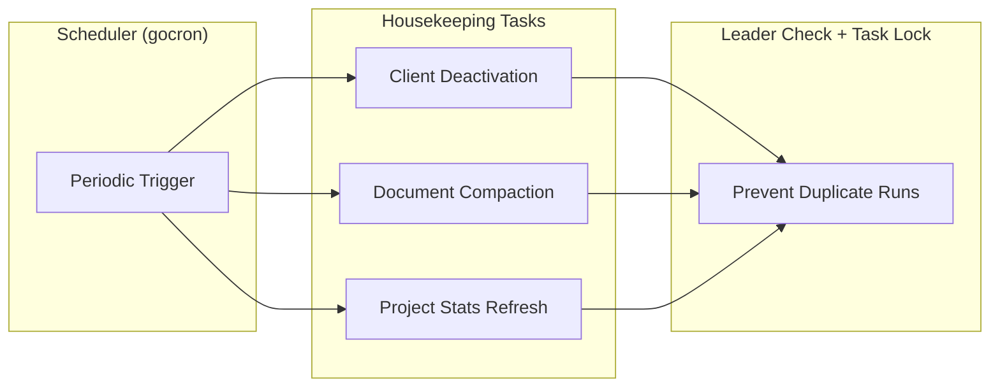
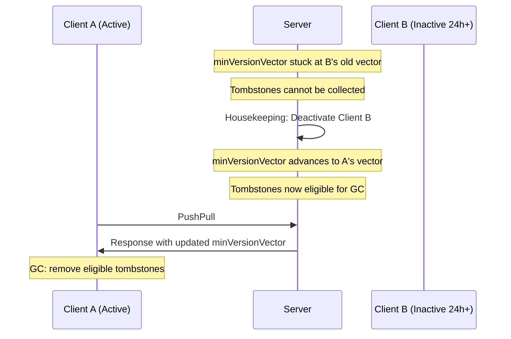

## Housekeeping

Housekeeping is a background service that periodically cleans up resources and data that are no longer needed in Yorkie. It plays a crucial role in maintaining performance and efficiency by managing memory usage and optimizing data storage in the CRDT-based collaborative system.

### Overview

As documents are edited over time, two types of overhead accumulate:

1. **Inactive clients** prevent [Garbage Collection](/docs/internals/crdt-concepts#garbage-collection) from reclaiming tombstoned nodes.
2. **Change history** grows continuously, increasing storage and memory costs.

Housekeeping addresses both with two scheduled tasks, and runs a third task that keeps per-project statistics up to date:

| Task | Purpose |
|------|---------|
| **Client Deactivation** | Deactivates clients that have been inactive beyond a threshold, enabling more effective garbage collection |
| **[Document Compaction](/docs/internals/synchronization#document-compaction)** | Consolidates old change history into a single snapshot to reduce storage overhead |
| **Project Stats Refresh** | Periodically recounts each project's activated clients and alive documents and stores the result in the project's stats |



### Client Deactivation for Garbage Collection

#### Why It Matters

In Yorkie's CRDT system, [Garbage Collection](/docs/internals/crdt-concepts#garbage-collection) uses the `minVersionVector` to determine which [tombstoned](/docs/internals/crdt-concepts#tombstones) nodes can be safely removed. The `minVersionVector` represents the minimum of all active clients' [version vectors](/docs/internals/crdt-concepts#version-vectors) -- the set of changes that every active client has definitely received.

If a client becomes inactive but remains registered, its outdated version vector holds back the `minVersionVector`, preventing garbage collection from reclaiming potentially large amounts of data.



#### How It Works

1. The scheduler triggers the deactivation task at the configured interval.
2. The task reads the next page of activated clients across all projects, up to `housekeeping-candidates-limit`, ordered by client ID and continuing after the last client seen in the previous run.
3. Each client is checked against its [Project](/docs/advanced/projects)'s `client-deactivate-threshold` (default: 24 hours). Clients that have not communicated with the server for longer than that are deactivated, removing them from the active client set. Up to `housekeeping-deactivate-concurrency` clients are deactivated in parallel.
4. The `minVersionVector` can now advance, unblocking garbage collection.

When the scan reaches the end of the client list, the cursor resets and the next run starts from the beginning. This spreads the work over several runs instead of scanning every client in a single cycle. Compaction and project stats refresh page through documents and projects the same way.

### Document Compaction

Over time, a document accumulates a large history of individual changes. Document Compaction reduces storage overhead by:

1. Removing old change history that is no longer needed for synchronization.
2. Creating a new initial change that represents the current document state.
3. Maintaining document integrity while reducing metadata size.

#### Compaction Criteria

A document is eligible for compaction when:

- Its server sequence (the number of changes stored for it) is at least `housekeeping-compaction-min-changes` (default: 1000).
- It is **not** currently attached to any client.

The second condition ensures that compaction does not interfere with active editing sessions. Document content remains identical after compaction -- only the internal change history is consolidated. An administrator can also force compaction of a single document, which skips the attachment check. Compaction bumps the document's [epoch](/docs/internals/synchronization#epoch), so a client still holding a checkpoint from before compaction must reattach.

### Configuration

Housekeeping is configured through `yorkie server` startup flags. The key parameters are:

| Parameter | Description | Default |
|-----------|-------------|---------|
| `housekeeping-interval` | Time between deactivation and compaction runs | `30s` |
| `housekeeping-candidates-limit` | Maximum number of candidates (clients, documents, or projects) processed by a task in a single run | `2000` |
| `housekeeping-deactivate-concurrency` | Maximum number of client deactivations run in parallel within a single run (`0` or `1` runs them sequentially) | `8` |
| `housekeeping-compaction-min-changes` | Minimum number of changes before a document is eligible for compaction | `1000` |
| `housekeeping-project-stats-refresh-interval` | Time between project stats refresh runs. Set to `0s` to disable the task | `5m` |

These can be set when starting the server:

```bash
$ yorkie server \
  --housekeeping-interval 30s \
  --housekeeping-candidates-limit 2000 \
  --housekeeping-deactivate-concurrency 8 \
  --housekeeping-compaction-min-changes 1000 \
  --housekeeping-project-stats-refresh-interval 5m
```

The inactivity threshold for client deactivation is not a server flag. It is a per-project setting, `client-deactivate-threshold`, which defaults to `24h` and can be changed with the [CLI](/docs/tools/cli#updating-the-project):

```bash
$ yorkie project update <project-name> \
  --client-deactivate-threshold 12h
```

#### Configuration by Environment

For **development**, use shorter intervals and lower thresholds for faster feedback:

```bash
$ yorkie server \
  --housekeeping-interval 10s \
  --housekeeping-candidates-limit 10 \
  --housekeeping-compaction-min-changes 100
```

For **production**, use longer intervals and higher limits to balance throughput with resource usage:

```bash
$ yorkie server \
  --housekeeping-interval 1m \
  --housekeeping-candidates-limit 5000 \
  --housekeeping-compaction-min-changes 5000
```

### Cluster Mode Behavior

In a [Cluster Mode](/docs/internals/cluster-mode) deployment, only the leader server executes housekeeping tasks. This is coordinated through leader election, preventing duplicate work across cluster nodes. Within a server, each task also takes a lock and skips the run if the previous one is still in progress.

For more on leader election, see [Cluster Mode: Architecture Components](/docs/internals/cluster-mode#architecture-components).

### Monitoring

Housekeeping logs its activity for observability:

```
HSKP: deactivation registered — interval=30s candidates_limit=2000 concurrency=8
HSKP: deactivation #3 <last-client-id> candidates 150/4210 deactivated 45/1033 cc=8 1.2s
HSKP: compaction #2 seq:0 id:<last-doc-id> candidates 89/89 compacted 12/12 1.8s
HSKP: project-stats #5 <last-project-id> refreshed 40/40 310ms
```

Each line shows the task, its term (one full pass over the candidates), the cursor the run started from, the candidates and processed items for this run and for the term so far, and the duration of the run. A run that processes nothing is not logged. Use these to tune configuration parameters for your workload.

### Further Reading

- [Housekeeping design document](https://github.com/yorkie-team/yorkie/blob/main/docs/design/housekeeping.md) -- Full technical design
- [CRDT Concepts: Garbage Collection](/docs/internals/crdt-concepts#garbage-collection) -- How GC uses version vectors to reclaim tombstones
- [Synchronization: Document Compaction](/docs/internals/synchronization#document-compaction) -- How compaction fits into the sync lifecycle
- [Garbage Collection design document](https://github.com/yorkie-team/yorkie/blob/main/docs/design/garbage-collection.md) -- Deep dive into the GC mechanism
- [Projects](/docs/advanced/projects) -- Per-project configuration including housekeeping thresholds
- [CLI: Updating the Project](/docs/tools/cli#updating-the-project) -- How to configure client deactivation threshold
- [Cluster Mode](/docs/internals/cluster-mode) -- Leader election and distributed coordination
- [Glossary](/docs/glossary) -- Definitions of all key terms
