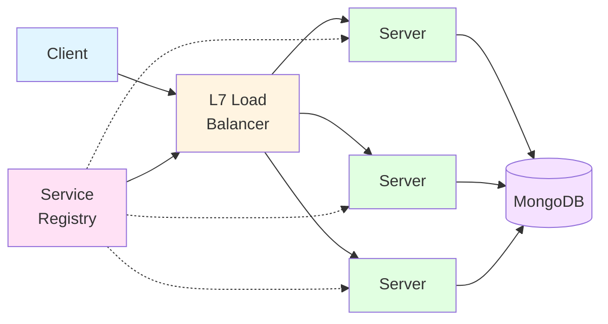

## Self-Hosted Server

This page explains how to run your own Yorkie Server.

To run a Yorkie Server, you need to install the CLI. If you haven't installed it yet, please refer to [CLI](/docs/tools/cli).

### Running a Server via CLI

Start a Server with the following command:

```bash
$ yorkie server

backend created: db: memory
serving RPC on 8080
serving profiling on 8081
```
The Server handles administrative requests such as project maintenance and continues to run until it receives termination commands such as Ctrl+C.
The Server stores its data using an in-memory database, which does not provide durability by default.

### Persistence

If you start the Server with a MongoDB address, you can permanently save the data stored by Yorkie.

> To start MongoDB, run `docker compose -f build/docker/docker-compose.yml up -d` in [the project root](https://github.com/yorkie-team/yorkie).

Then, start a Yorkie Server with `--mongo-connection-uri` flag to connect the MongoDB.

```bash
$ yorkie server --mongo-connection-uri mongodb://localhost:27017

MongoDB connected, URI: mongodb://localhost:27017, DB: yorkie-meta
backend created: db: mongodb://localhost:27017
serving profiling on 8081
serving RPC on 8080
```

The Server prints the MongoDB URI with any password in it masked.

### Production Settings

The defaults above suit local development. Before you run the Server anywhere else, configure the following:

- **Admin token signing key**: The Server signs admin (Dashboard and CLI) tokens with the key given by `--backend-secret-key` or the `YORKIE_BACKEND_SECRET_KEY` environment variable. If neither is set, it generates a random key at startup, so admin tokens stop working whenever the Server restarts. Every node of a cluster must use the same key, and the key must be at least 32 characters.
- **Default admin user**: On first start, the Server creates the admin user `admin` with the password `admin`. Set `--backend-admin-user` and `--backend-admin-password` before the first start, or log in and change the password with `yorkie passwd`. The flags only apply when the user is created, so changing them later does not change an existing password.
- **Credentials**: Flag values are visible to anyone who can list the processes on the host. Pass credentials through environment variables instead: `YORKIE_MONGO_CONNECTION_URI` for `--mongo-connection-uri`, `YORKIE_CLUSTER_SECRET` for `--cluster-secret`, and `YORKIE_AUTH_GITHUB_CLIENT_SECRET` for `--auth-github-client-secret`.

```bash
$ export YORKIE_BACKEND_SECRET_KEY="$(openssl rand -base64 32)"
$ export YORKIE_MONGO_CONNECTION_URI="mongodb://<user>:<password>@<host>:27017"
$ yorkie server
```

### Monitoring

The Server exports metrics under the `/metrics` path on its profiling port. Fetch the metrics with curl:

```bash
$ curl http://localhost:8081/metrics

yorkie_server_version{server_version="{{YORKIE_VERSION}}"} 1
# HELP yorkie_pushpull_received_changes_total The total count of changes included
# TYPE yorkie_pushpull_received_changes_total counter
yorkie_pushpull_received_changes_total 6
...
```

These metrics can be collected by [Prometheus](https://prometheus.io/).
The profiling port also serves Go runtime profiles under `/debug/pprof/` when you start the Server with `--pprof-enabled`.

Running [Prometheus](https://prometheus.io/) and [Grafana](https://grafana.com/oss/grafana/) is the easiest way to monitor the Server's metrics.

The [docker folder](https://github.com/yorkie-team/yorkie/tree/main/build/docker) of the Yorkie repository has a Compose file that starts Prometheus, Grafana, MongoDB, and a Yorkie Server built from source.
Clone the repository and start the applications with Docker Compose:

```bash
$ git clone https://github.com/yorkie-team/yorkie
$ cd yorkie/build/docker
$ docker compose -f docker-compose-full.yml up --build -d

[+] Running 4/4
 ✔ Container yorkie-mongo-1       Started
 ✔ Container yorkie-prometheus-1  Started
 ✔ Container yorkie-grafana-1     Started
 ✔ Container yorkie-yorkie-1      Started
```

<Alert status="warning">The Compose file runs its own Yorkie Server on ports 8080 and 8081 and MongoDB on port 27017. Stop any `yorkie server` or MongoDB you started earlier on this page first, or the ports clash.</Alert>

Now, Prometheus will collect Server metrics every 5 seconds.

Grafana runs on `http://localhost:3000`, and you can log in with `admin` and `admin`. The Prometheus data source is already provisioned with the name `Prometheus`, so you do not need to add it.

Then, import the [default Yorkie dashboard template](https://grafana.com/grafana/dashboards/18560-yorkie-dashboard/) and customize it. Select the `Prometheus` data source when you import it. If you use a data source with a different name, such as `my-prometheus`, the datasource field values in JSON also need to be `my-prometheus`.

Sample dashboard:

<Image alt="dashboard" src="/assets/images/docs/dashboard.png" width={600} height={626} style={{ maxWidth: '600px' }} />

### Sharded Cluster

In a production environment, a server cluster is necessary to handle large workloads while ensuring high availability, reliability, and scalability.

Yorkie provides a sharded cluster in Kubernetes environments to support production environments.

This section describes how to set up a sharded cluster. An example of the sharded cluster architecture:



- L7 Load Balancer: It is responsible for routing requests to servers based on the computed request’s hash key and consistent hashing algorithm.
- Service Registry: It is responsible for storing metadata and configuration settings for Yorkie servers.
- MongoDB: It stores the data of Yorkie. It can be configured to use sharding, just like Yorkie sharded cluster.

Yorkie provides a Helm Chart, a package manager for Kubernetes, to easily deploy a Yorkie cluster on Kubernetes with the above components configured.

Below are guides for deploying Yorkie cluster on Kubernetes with Helm Charts on various platforms.

- [Minikube Installation](/docs/self-hosted-server/minikube): Guide to install Yorkie cluster on Minikube.
- [AWS EKS Installation](/docs/self-hosted-server/aws-eks): Guide to install Yorkie cluster on AWS EKS.

Also, you can additionally deploy Yorkie cluster addons on Kubernetes with Helm Charts on your own environment.

Yorkie cluster addons include:

- Monitoring: Provides Yorkie metrics and logging via Grafana dashboard.
- Analytics: Collects usage events of Yorkie cluster with Kafka and StarRocks.
- GitOps: Provides Yorkie Continuous Delivery via ArgoCD.

Below is guide for deploying Yorkie cluster addons on Kubernetes with Helm Charts.

- [Cluster Addons Installation](/docs/self-hosted-server/cluster-addons): Guide to install Yorkie cluster addons on Kubernetes.
