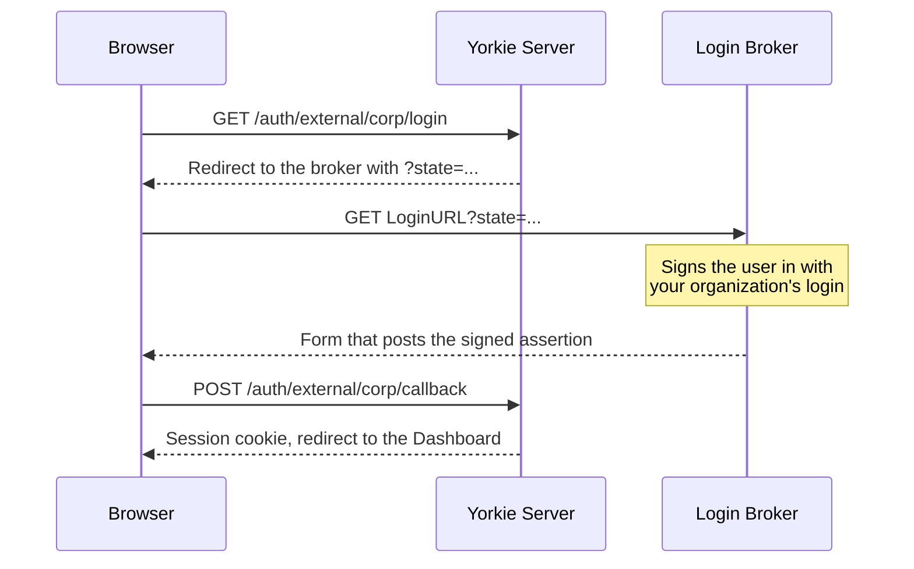

## Dashboard Login

This page explains how users of your self-hosted Server sign in to the Dashboard.

The Dashboard offers these sign-in methods:

- **Username and password**: Always on. Users sign up on the Dashboard.
- **GitHub**: Users sign in with their GitHub account.
- **Organization SSO**: Users sign in through your organization's login system, connected by a login broker you run.

The Dashboard asks the Server for the enabled methods when it loads (`GET /auth/providers`) and shows a button for each. You configure them on the Server only; the Dashboard needs no rebuild.

<Alert status="info">Organization SSO and the `/auth/providers` endpoint are available from Yorkie v0.7.29.</Alert>

### Before You Start

GitHub login and organization SSO share these requirements:

- **HTTPS**: The Server sets its login cookies with the `Secure` attribute, so browsers keep them only over HTTPS.
- **Same site**: The session cookie belongs to the API host and uses `SameSite=Strict`. Serve the Dashboard and the API from the same site, such as `dashboard.example.com` and `api.example.com`.
- **Redirect URL**: After a login, the browser goes to `--auth-github-callback-redirect-url`. Set it to your Dashboard URL, such as `https://dashboard.example.com/dashboard`. Despite its name, it applies to every login method.
- **One pod for `/auth`**: The Server keeps pending logins in memory. When you run several Servers, the requests under `/auth` must reach the same one. The [Helm Chart](https://github.com/yorkie-team/yorkie/tree/main/build/charts/yorkie-cluster) routes them to a single pod through its Istio gateway. With another load balancer, pin `/auth` to one Server yourself.

### GitHub Login

[Create a GitHub OAuth App](https://docs.github.com/en/apps/oauth-apps/building-oauth-apps/creating-an-oauth-app) and set its callback URL to `https://<API_HOST>/auth/github/callback`. Then start the Server with the app's client ID and secret:

```bash
$ export YORKIE_AUTH_GITHUB_CLIENT_SECRET="<CLIENT_SECRET>"
$ yorkie server \
  --auth-github-client-id "<CLIENT_ID>" \
  --auth-github-redirect-url "https://api.example.com/auth/github/callback" \
  --auth-github-callback-redirect-url "https://dashboard.example.com/dashboard"
```

With the Helm Chart, set `yorkie.args.githubClientID`, `yorkie.args.githubClientSecret`, `yorkie.args.githubRedirectURL`, and `yorkie.args.githubCallbackRedirectURL`. The chart passes the secret as an environment variable.

The Dashboard shows "Sign in with GitHub" once the client ID is set.

### Organization SSO

Organization login systems differ: some follow OAuth2 or OIDC, many do not. Yorkie leaves that protocol to a **login broker**, a small service you run next to your login system. The broker signs users in however your organization does, then hands Yorkie a short-lived token, an *assertion*, signed with its private key. The Server checks the assertion with the broker's public key.



The assertion travels through the browser, so the Server and the broker need no network path between them.

#### 1. Generate a Key Pair

The broker signs assertions with an ECDSA P-256 key (ES256). Generate one with `openssl`:

```bash
$ openssl ecparam -name prime256v1 -genkey -noout -out broker.key
$ openssl ec -in broker.key -pubout -out broker.pub
```

`broker.key` stays with the broker. `broker.pub` goes into the Server configuration. The Server configuration holds public keys only, so leaking it does not let anyone sign in.

#### 2. Configure the Server

List the provider in the `RPC.Auth.ExternalProviders` section of the Server config file:

```yaml
RPC:
  Auth:
    GitHubCallbackRedirectURL: "https://dashboard.example.com/dashboard"
    ExternalProviders:
      - Name: corp
        DisplayName: "Company SSO"
        LoginURL: "https://login-broker.example.com/login"
        Issuer: "login-broker"
        Audience: "yorkie-admin"
        PublicKeys:
          - |
            -----BEGIN PUBLIC KEY-----
            ...
            -----END PUBLIC KEY-----
```

- `Name`: Identifies the provider in its URLs, `/auth/external/<Name>/login` and `/auth/external/<Name>/callback`. Up to 32 lowercase letters, digits, and hyphens, starting and ending with a letter or digit.
- `DisplayName`: The label of the Dashboard button.
- `LoginURL`: Where the Server sends the browser to sign in. It must be `https`, or `http` on localhost.
- `Issuer`, `Audience`: Must match the `iss` and `aud` claims of the assertion.
- `PublicKeys`: PEM-encoded P-256 public keys. Any of them can verify an assertion. To rotate the broker key, list both the old and the new key, switch the broker to the new key, then remove the old one.

Without a config file, put the `ExternalProviders` list in a YAML file of its own and pass it with `--auth-external-providers-file`:

```bash
$ yorkie server \
  --auth-external-providers-file ./external-providers.yaml \
  --auth-github-callback-redirect-url "https://dashboard.example.com/dashboard"
```

With the Helm Chart, set the list as `yorkie.args.externalProviders` in your values file. The chart stores it in a ConfigMap and restarts the pods when it changes:

```yaml
yorkie:
  args:
    githubCallbackRedirectURL: "https://dashboard.example.com/dashboard"
    externalProviders:
      - Name: corp
        DisplayName: "Company SSO"
        LoginURL: "https://login-broker.example.com/login"
        Issuer: "login-broker"
        Audience: "yorkie-admin"
        PublicKeys:
          - |
            -----BEGIN PUBLIC KEY-----
            ...
            -----END PUBLIC KEY-----
```

The Server refuses to start when a provider has an invalid name, `LoginURL`, or key, or when two providers share a name.

#### 3. Build the Broker

The broker receives the browser at `LoginURL?state=<STATE>`. It must:

1. Sign the user in with your organization's login system. Yorkie trusts every assertion the broker signs.
2. Sign a JWT with ES256 that carries the claims below. Put the `state` it received back unchanged.
3. Return an HTML form that posts the JWT as the `assertion` field to `https://<API_HOST>/auth/external/<Name>/callback`. Do not put the assertion in a URL, where access logs and browser history keep it.
4. Keep `state` out of its logs and send `Referrer-Policy: no-referrer`. A leaked state lets someone else finish that login.

| Claim | Required | Value |
|-------|----------|-------|
| `iss` | Yes | The provider's `Issuer` |
| `aud` | Yes | The provider's `Audience` |
| `sub` | Yes | The user's ID in your organization. It must never change for a person and never be reused for another. |
| `state` | Yes | The `state` query parameter the broker received |
| `iat`, `exp` | Yes | Issued-at and expiry. `exp - iat` must be at most 60 seconds. |
| `jti` | Yes | A unique ID. The Server refuses an assertion whose `jti` it has seen. |
| `preferred_username` | No | The Yorkie username for a new user. `sub` is used without it. |

An example in Go with [golang-jwt](https://github.com/golang-jwt/jwt):

```go
// After the broker has signed the user in.
claims := jwt.MapClaims{
	"iss":                "login-broker",
	"aud":                "yorkie-admin",
	"sub":                employeeID,
	"preferred_username": loginName,
	"state":              r.URL.Query().Get("state"),
	"iat":                now.Unix(),
	"exp":                now.Add(30 * time.Second).Unix(),
	"jti":                uuid.NewString(),
}
assertion, err := jwt.NewWithClaims(jwt.SigningMethodES256, claims).SignedString(privateKey)
if err != nil {
	http.Error(w, "failed to sign", http.StatusInternalServerError)
	return
}

w.Header().Set("Referrer-Policy", "no-referrer")
fmt.Fprintf(w, `<form method="post" action="%s"><input type="hidden" name="assertion" value="%s"></form>
<script>document.forms[0].submit()</script>`,
	html.EscapeString("https://api.example.com/auth/external/corp/callback"),
	html.EscapeString(assertion))
```

#### Users and Usernames

The Server identifies an organization user by the provider and `sub`. On the first login it creates a user named `preferred_username`, or `sub` without it. A returning user keeps that name even if `preferred_username` changes later.

The first login fails when:

- The username is not a valid Yorkie username: 2 to 30 characters of lowercase letters, digits, `-`, `.`, `_`, and `~`.
- Another user already holds the username. The Server does not add a suffix, because project members are invited by username and a suffixed name would invite the wrong person.

Users signed in through a provider manage their password there, so the Dashboard hides the password change for them.

#### Moving Existing Accounts

Projects refer to users by their internal ID, so an existing account keeps its projects when it moves to a provider. To let `alice`, who signed in with GitHub, sign in through the `corp` provider with the ID `employee-1001`, update the user in MongoDB:

```js
db.users.updateOne(
  { username: 'alice', auth_provider: 'github' },
  { $set: { auth_provider: 'external:corp', subject: 'employee-1001' } },
);
```

The user then signs in only through `corp`.

### Troubleshooting

The Server logs the cause of every failed login and returns a short message to the browser:

| Status | Message | Cause |
|--------|---------|-------|
| 400 | `invalid state` | The login took longer than 10 minutes, another login started in a different tab, or the callback reached a different Server than the login did. |
| 401 | `Failed to sign in` | GitHub refused the login, or the assertion failed verification: wrong key, `iss`, or `aud`, expired, or a reused `jti`. |
| 400 | `The username from the provider is not a valid username` | `preferred_username` (or `sub`) is not a valid Yorkie username. |
| 409 | `Username is already used by another account` | Another user already holds the username. |
| 503 | `Too many logins in progress` | 10,000 logins are waiting to finish on that Server. |

If no button appears on the Dashboard, check `https://<API_HOST>/auth/providers`. It lists the providers the Server loaded.
